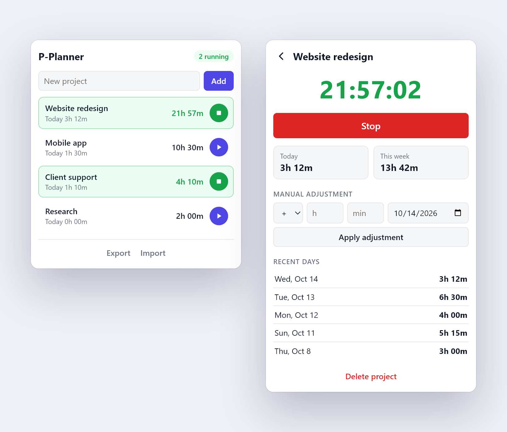

  

<h1 align="center">P-Planner</h1>

Track working hours per project from your browser toolbar.

  

## Features

- Start/stop timer per project, several at once
- Keeps counting with the popup or browser closed
- Add or subtract time manually on any date
- Today, this week and per-day totals
- Synced across devices through Brave/Chrome Sync
- JSON export and import
- Light and dark mode

## Install

1. Download `P-Planner-vX.Y.Z.zip` from the [latest release](https://github.com/creep33/P-Planner/releases/latest) and unzip it into a permanent folder.
2. Open `brave://extensions` (or `chrome://extensions`) and turn on **Developer mode**.
3. Click **Load unpacked** and select the unzipped folder.

To update, unzip the new version over the same folder and click ⟳ on the extension card.

## Sync

On each device, turn on **Settings → Sync → Extensions** and install the same zip.
If your data does not sync, use **Export** on one device and **Import** on the other.

## Privacy

No accounts, servers or analytics. See [PRIVACY.md](PRIVACY.md).

## License

[MIT](LICENSE)
